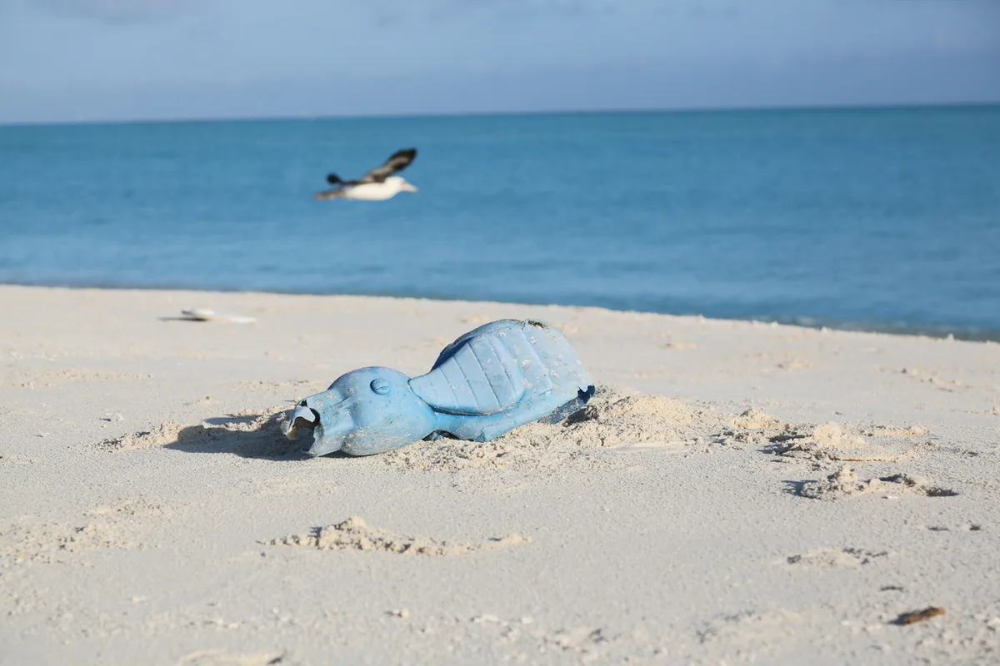
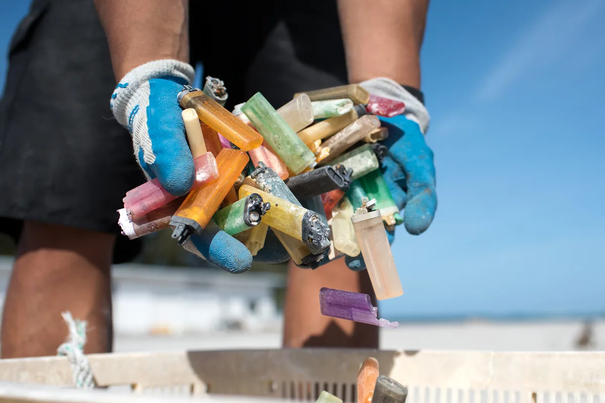
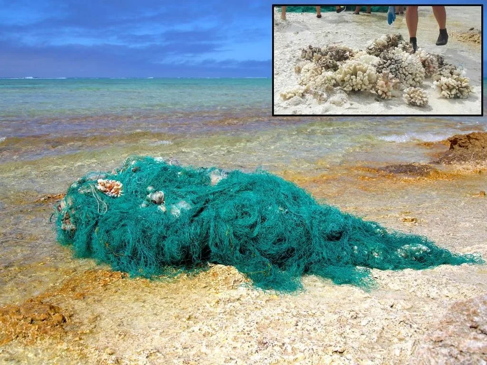

# AI for Oceans: A Simple Activity with a Bigger Lesson About Data

Planned date (Australia/Sydney): 2026-10-14

Target keywords: ai for oceans

SEO title: AI for Oceans: A Guide to Data and Learning | CodeMax

Meta description: Explore Code.org’s AI for Oceans learning activity and use it to understand training examples, classification mistakes and the limits of an AI demonstration.

AI for Oceans is an educational activity from Code.org that introduces machine-learning ideas through an ocean-themed exercise. It is a learning simulation, not a live system removing rubbish from the sea. That distinction matters because the activity is useful precisely when you discuss what its simplified examples teach.

The real photographs below are historical context for discussion, not screenshots or outputs of the activity. CodeMax is not affiliated with Code.org or NOAA.

## What the activity is designed to illustrate
The lesson asks learners to classify examples, including distinguishing fish from things that are not fish. Later exercises explore other categories. This gives a concrete way to discuss how the examples supplied to a system influence what it learns to recognise.

Open the official lesson rather than an imitation site. A teacher or parent can review the instructions first and decide how to support the learner. The activity's interface may change, but the central discussion about data and classification remains useful.

Context photograph from NOAA’s 2016 marine-debris journal. A toy shaped like an animal makes a useful discussion prompt: appearance and category are not the same thing. Credit: NOAA Fisheries. [Original NOAA source](https://www.fisheries.noaa.gov/science-blog/marine-debris-2016-photo-journal).

## Make a prediction before the next result
Ask the learner what they expect the system to do and why. After seeing an output, compare it with that expectation. Was the category clear? Were the examples varied? Did the learner accidentally teach a pattern that was not the intended rule?

This turns clicking through the exercise into an investigation. The goal is not to get every response right immediately. It is to notice how choices in the training examples can affect later decisions and how a mistake can reveal a missing case.

## Discuss the difference between a label and reality
A category name can seem simple while its boundaries are ambiguous. An unusual shape, colour or object may expose that ambiguity. Ask whether two people would always label the same example the same way.

For a follow-up away from the screen, sort a set of ordinary objects using a rule such as things used for drawing. Discuss objects that could belong in more than one group. This original extension helps learners see that labels are decisions made by people, not properties a computer automatically understands perfectly.

Discarded lighters collected at Midway Atoll, documented on 23 April 2016. Different colours can share one category; this is a real cleanup photograph, not training data from AI for Oceans. Credit: NOAA Fisheries/David Slater. [Original NOAA source](https://www.fisheries.noaa.gov/science-blog/marine-debris-2016-photo-journal).

## Avoid overstating what the demonstration proves
Completing the activity does not show that a system understands the ocean, ecology or all kinds of visual data. It demonstrates a limited learning problem. Real-world systems need broader data, evaluation and an understanding of the consequences of mistakes.

Ask learners to name something the activity cannot tell them. For example, can a classification result explain whether an object is dangerous to wildlife? That question requires information beyond the simple label in the exercise.

A net removed from Seal-Kittery Island at Pearl and Hermes Atoll during NOAA’s 2016 mission. NOAA’s original inset shows coral; this documents real-world consequences, not an outcome of the Code.org activity. Credit: NOAA Fisheries. [Original NOAA source](https://www.fisheries.noaa.gov/science-blog/marine-debris-2016-photo-journal).

## End with questions, not just a score
Invite the learner to explain what examples they would add and which mistakes they would test next. Ask how a system might behave if an important type of example never appeared during training. Their explanation is more informative than whether they reached the final screen.

AI for Oceans is a useful entry point into AI literacy because it makes an abstract topic approachable. Use it as the beginning of a conversation about data, assumptions and evidence, rather than proof that AI can solve every environmental problem.

## Sources and further reading

- [Code.org: AI for Oceans design notes and activity source](https://github.com/code-dot-org/ml-activities)

- [Code.org: AI for Oceans lesson](https://studio.code.org/courses/oceans/units/1/lessons/1)

Source-based explainer researched 30 September 2026; activity sources and photograph rights rechecked 14 October 2026. Examples are illustrative unless identified as reported research.

[Explore AI insights](https://codemax.com.au/blog/ai/)

## Release review — 14 October 2026

Primary-source claim check: Code.org's official lesson URL responds and its public ml-activities repository confirms fish/trash classification, introducing non-fish creatures, and later adjective-based categories. The live lesson content is client-rendered; the repository design notes were used to verify the sequence, without claiming hands-on testing. Teaching prompts in this article are CodeMax suggestions. This remains an educational explainer, not news or evidence of a real ocean-cleaning AI.

### Photograph rights and provenance

All three originals were checked individually on 14 October 2026 against [NOAA's 2016 photo journal](https://www.fisheries.noaa.gov/science-blog/marine-debris-2016-photo-journal) and its [photo copyright policy](https://www.fisheries.noaa.gov/national/about-us/website-policies-and-disclaimers). The selected credits are NOAA Fisheries / NOAA Fisheries–David Slater, not a separately credited third-party rights holder. NOAA-created photos may be reused without permission under that policy (not subject to US copyright); the requested NOAA credit and source link are provided. No NOAA logo, endorsement, or affiliation is asserted. The selected photos contain no identifiable face. Context captions explicitly distinguish these historical photographs from the Code.org exercise.

| Local asset | Original image | Creator/source credit | Context and treatment |
| --- | --- | --- | --- |
| oceans-noaa-toy.webp | https://media.fisheries.noaa.gov/dam-migration-miss/1280_UwTuWTd4Fx41.jpg?1562963074= | NOAA Fisheries | 2016 journal, Sand Island section. The surrounding webpage caption calls the object a motorcycle, but the actual selected file clearly shows a bird-shaped toy: the article describes only the visible object and does not repeat that inconsistent identification. Resized without cropping, 1200×800. |
| oceans-noaa-lighters.webp | https://media.fisheries.noaa.gov/dam-migration-miss/1280_IMKL0W0ZwC58.jpg?1562966671= | NOAA Fisheries/David Slater | Sorting section, 23 April 2016, Midway Atoll. Resized without cropping, 1200×800. |
| oceans-noaa-reef-net.webp | https://media.fisheries.noaa.gov/dam-migration-miss/1280_AsUZU6GlTC11.jpg?1562968132= | NOAA Fisheries | Fishing Net section, Seal-Kittery Island, 2016. Original NOAA photographic inset retained and described, 1024×768. |

Optimisation: RGB WebP, original proportions retained, no generated imagery or fabricated screenshot; explicit dimensions, descriptive alt text and lazy loading on all three integrated figures. Original orange/charcoal learning SVG retained and not counted as a real image. The exact three asset paths are added to the existing production router allowlist so they resolve on the primary domain; no broader routing changes.
