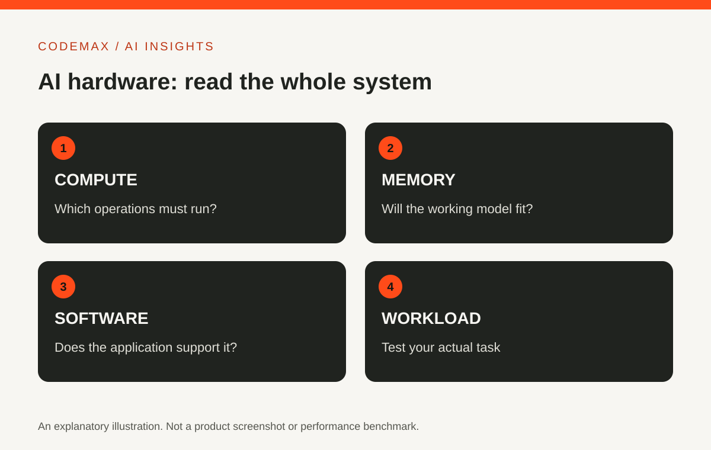

# NVIDIA DGX Explained: Why AI Infrastructure Is More Than a GPU

Planned date (Australia/Sydney): 2026-10-17

Target keywords: nvidia dgx

SEO title: NVIDIA DGX: AI Infrastructure Explained | CodeMax

Meta description: Explore what NVIDIA DGX is, how AI infrastructure differs from a desktop upgrade, and which workload questions matter before comparing systems.

NVIDIA DGX is a family of AI computing systems and associated platform technology. The name does not identify one universal computer specification. When reading a DGX announcement, first establish the exact system, intended workload and deployment environment being described.

## A system includes more than processors
AI workloads depend on memory, storage, networking and software as well as compute. A powerful processor can still wait for data or run out of usable memory. NVIDIA's DGX documentation presents the platform as a combination of infrastructure and software for AI work.

[NVIDIA's GPU performance guide](https://docs.nvidia.com/deeplearning/performance/dl-performance-gpu-background/index.html) explains why memory bandwidth, computation and latency can each limit performance. Comparing systems using a single peak-performance number is therefore incomplete. The model, numerical precision, batch size and workload shape affect what that number means in practice. A headline result from one benchmark may not predict the experience of running your application.

<figure><figcaption>An HGX B200 GPU board photographed on 7 September 2025, illustrating the hardware inside larger AI systems; this is not a complete installed DGX server. Photo: Pokiiri, <a href="https://commons.wikimedia.org/wiki/File:Nvidia_DGX-B200-HGX.jpg">original on Wikimedia Commons</a>, <a href="https://creativecommons.org/licenses/by-sa/4.0/">CC BY-SA 4.0</a>. Resized and converted to WebP; this image remains CC BY-SA 4.0.</figcaption></figure>

## Training and inference need different questions
[Training and inference](https://www.nvidia.com/en-us/glossary/ai-inference/) are different stages: training adjusts a model using data, while inference applies a trained model to inputs to produce outputs. Both can require substantial resources, but their bottlenecks and operating patterns may differ. A system chosen for large training jobs is not automatically the most economical way to serve occasional requests.

Describe your workload before comparing products. How large is the model? How many users or jobs must run at once? What response time matters? Which software must be supported? Those answers make a discussion about hardware more concrete.

## Read specifications as a complete configuration
Check the exact product documentation for memory, supported components and environmental requirements. Do not transfer a specification from one DGX product to another merely because the names are similar. Desktop-oriented and data-centre systems have different assumptions. For example, [DGX Spark documentation](https://docs.nvidia.com/dgx/dgx-spark/hardware.html) describes a compact desktop system, whereas the [DGX B200 guide](https://docs.nvidia.com/dgx/dgxb200-user-guide/introduction-to-dgxb200.html) describes a rack-mounted system with separate power and installation requirements. These are different products, not interchangeable configurations.

<figure><figcaption>DGX Spark, photographed on 16 May 2026, shows the desktop side of the DGX family. Photo: Daniel Lu (dllu), <a href="https://commons.wikimedia.org/wiki/File:Nvidia_DGX_front_view_dllu.jpg">original on Wikimedia Commons</a>, <a href="https://creativecommons.org/licenses/by-sa/4.0/">CC BY-SA 4.0</a>. Resized and converted to WebP; this image remains CC BY-SA 4.0.</figcaption></figure>

For a deployment conversation, include the people operating the system. Ask about installation, updates, monitoring and support. A purchase decision that ignores those responsibilities can underestimate the work required to keep an AI service dependable.

## Compare ownership with access
Depending on the project, you may evaluate local equipment, shared infrastructure or rented compute. Each approach has different implications for scheduling, data movement and operating effort. Use the same workload and evaluation criteria when comparing them.

Avoid reducing the decision to a claim that local hardware is always private or cloud infrastructure is always cheaper. Actual data handling and costs depend on the complete configuration. Seek a measured pilot where possible rather than extrapolating from a promotional demo.

## What an everyday reader should take away
DGX announcements matter because AI capabilities depend on the systems that train and run models. But you do not need enterprise AI infrastructure simply to use an online assistant. In that case, the provider operates the underlying compute.

When you encounter an infrastructure headline, ask which users it serves and what work becomes possible or more practical. That connects the specification to a real outcome while keeping the distinction between a vendor claim, a benchmark and your own measured result clear.

## Sources and further reading

- [NVIDIA: DGX platform documentation](https://docs.nvidia.com/dgx/)
- [NVIDIA: GPU performance background](https://docs.nvidia.com/deeplearning/performance/dl-performance-gpu-background/index.html)
- [NVIDIA: AI inference and training](https://www.nvidia.com/en-us/glossary/ai-inference/)
- [NVIDIA: DGX Spark hardware overview](https://docs.nvidia.com/dgx/dgx-spark/hardware.html)
- [NVIDIA: DGX B200 system introduction](https://docs.nvidia.com/dgx/dgxb200-user-guide/introduction-to-dgxb200.html)

Source-based explainer originally researched on 30 September 2026; facts, links and image reuse terms checked on 17 October 2026. Product features and availability can change. Examples and evaluation suggestions are illustrative, not CodeMax benchmark results. This independent article is not endorsed by NVIDIA or the photographers.

[Explore AI insights](https://codemax.com.au/blog/ai/)

## Publication review — 17 October 2026

The original subject, target keyword, planned date and orange/charcoal hardware SVG are unchanged. The following checks were performed against current official documentation, not third-party specifications:

- DGX platform documentation confirms the infrastructure/software scope, management tools and I/O considerations.
- GPU performance background, sections 2–4, explains precision, bandwidth, latency and batch-size dependence. No benchmark, speed-up, price or model-size promise is made here.
- NVIDIA's inference glossary supports the training/inference distinction.
- Spark hardware overview identifies the compact desktop configuration; the B200 introduction identifies its rack-mounted configuration and power requirements. The photographs are contextual, not evidence of a CodeMax installation, test or vendor affiliation.
- The ownership/pilot questions are editorial evaluation suggestions, not reported experimental outcomes.

### Image provenance and reuse record

Both photographs were individually checked on 17 October 2026 on their original creator-uploaded Wikimedia Commons file pages. Both pages identify the image as the uploader's own work and license it CC BY-SA 4.0. Reuse permits sharing and adaptation with credit, licence link, change indication and share-alike for adaptations. The published captions satisfy these requirements and explicitly retain CC BY-SA 4.0 for the converted images; no endorsement is implied.

| Local asset | Creator and historical date | Original source | Reuse and changes |
| --- | --- | --- | --- |
| `public/article-media/dgx-b200-board-2025.webp` (1200 × 1218) | Pokiiri; 7 September 2025 | https://commons.wikimedia.org/wiki/File:Nvidia_DGX-B200-HGX.jpg | [CC BY-SA 4.0](https://creativecommons.org/licenses/by-sa/4.0/); resized from 2977 × 3021 and converted to WebP; no crop or content alteration. Shows an HGX B200 board, not a complete DGX server. |
| `public/article-media/dgx-spark-front-2026.webp` (1200 × 675) | Daniel Lu (dllu); 16 May 2026 | https://commons.wikimedia.org/wiki/File:Nvidia_DGX_front_view_dllu.jpg | [CC BY-SA 4.0](https://creativecommons.org/licenses/by-sa/4.0/); resized from 10752 × 6048 and converted to WebP; no crop or content alteration. |

Original downloads:

- https://upload.wikimedia.org/wikipedia/commons/4/45/Nvidia_DGX-B200-HGX.jpg
- https://upload.wikimedia.org/wikipedia/commons/1/19/Nvidia_DGX_front_view_dllu.jpg

Both real photographs are integrated into the relevant sections with descriptive alt text, visible historical captions, creator credit, original-source links, explicit dimensions, lazy loading and async decoding. The existing responsive article CSS constrains image width and preserves aspect ratio. Exact production-router asset paths are included so these images are served by the new site rather than legacy WordPress.
