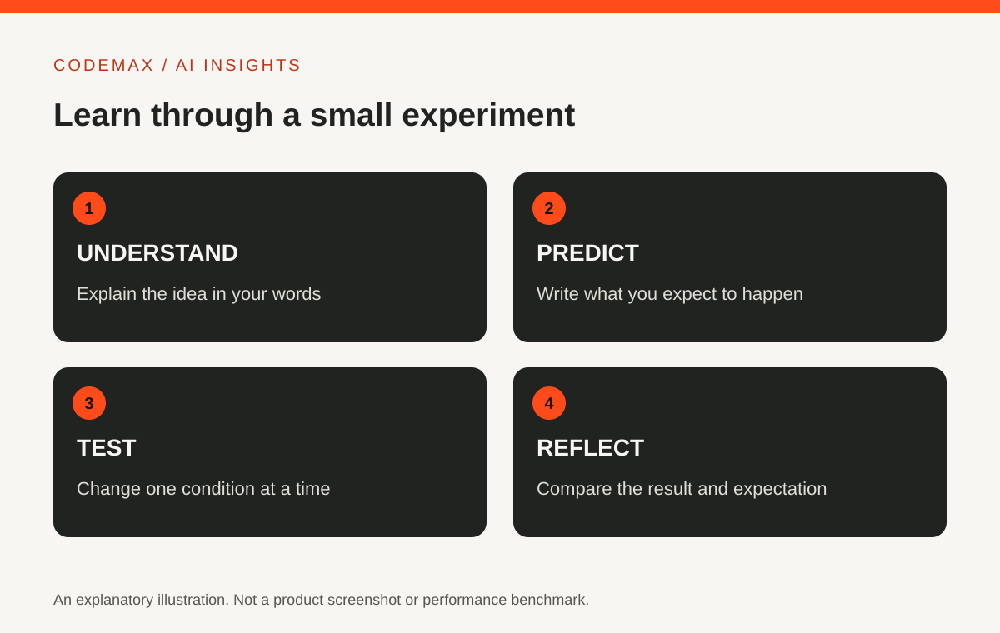

# Cognitive Class AI: Choose a Course You Will Actually Finish

Planned date (Australia/Sydney): 2026-10-18

Target keywords: cognitiveclass ai

SEO title: Cognitive Class AI: Plan Your Learning Path | CodeMax

Meta description: Explore Cognitive Class AI courses and build a realistic learning path around your goal, prerequisites, practice time and a small finished project.

Cognitive Class is an online learning platform with courses and projects covering subjects such as AI, data science and cloud computing. Searching for CognitiveClass AI can lead to a large catalogue. The useful first step is choosing a learning goal, not enrolling in every interesting course.

## Decide what you want to be able to do
A general introduction to AI serves a different purpose from learning to build a model. You might want to understand terminology, use generative tools more effectively or develop programming skills. Write a concrete outcome before choosing a course.

For example, explain the difference between training and inference is a manageable first goal. Build and evaluate a small classifier is a more technical one. Neither is inherently better; the right choice depends on your starting point and available time.

<figure><figcaption>Plan one learning outcome before opening another course. Contextual photograph by Eric Bailey, 21 May 2014; not a Cognitive Class classroom or interface. <a href="https://commons.wikimedia.org/wiki/File:Laptop_picture_with_notepad.jpg">Original source</a> · <a href="https://creativecommons.org/publicdomain/zero/1.0/">CC0</a>. Converted to WebP.</figcaption></figure>

## Read the syllabus and prerequisites
Cognitive Class's catalogue includes introductory AI material, prompt engineering and other technical subjects. Check the individual course page for its current syllabus, format and requirements. The title alone may not tell you how much programming or mathematics is involved.

If a prerequisite is unfamiliar, spend time on it before proceeding. Skipping foundations can make later exercises feel harder than they need to be. Conversely, someone with relevant experience may not need to complete every introductory module in order.

For a concrete comparison, [Introducing AI](https://cognitiveclass.ai/courses/introducing-ai-09f5c2a8-b79c-443d-b09a-8227c40c2108) is listed as a beginner course requiring basic computer literacy, while [Prompt Engineering for Everyone](https://cognitiveclass.ai/courses/prompt-engineering-for-everyone) lists no technical requirements and includes hands-on labs. These are course-page descriptions checked on 19 October 2026, not CodeMax test results.

## Budget for practice, not just watching
An estimated course duration is a guide, not a promise about your personal learning time. Leave room to repeat exercises, investigate errors and make notes. A video can feel clear while watching it but be difficult to reproduce without assistance.

After a lesson, close the instructions and explain the main idea in your own words. If there is a coding exercise, change a small part and predict what will happen. This makes the learning more active than simply reaching the final screen.

<figure><figcaption>Hands-on programming practice at WikiConference India in Mohali, 7 August 2016. This historical photograph illustrates collaborative learning, not a Cognitive Class event. Credit: Biswarup Ganguly, <a href="https://commons.wikimedia.org/wiki/File:Shivangi_Aneja_and_Palash_Rastogi_Study_Writing_Mediawiki_Bot_in_Python_-_Wiki_Conference_India_-_CGC_-_Mohali_2016-08-07_8413.JPG">original source</a>, <a href="https://creativecommons.org/licenses/by/3.0/">CC BY 3.0</a>. Resized and converted to WebP; no endorsement implied.</figcaption></figure>

## Build one small result
Choose a project that demonstrates the concept you are learning. For an introductory course, that might be an illustrated explanation or a comparison of two approaches. For a technical course, it could be a reproducible notebook with a clear evaluation.

Keep the project small enough to finish. Record the source material, assumptions and limitations. A completed example you can explain is more useful than a large unfinished project assembled from steps you do not understand.

## Interpret certificates carefully
The platform advertises certificates and badges, but availability differs by course. At the 19 October 2026 check, Introducing AI listed no certificate, while Prompt Engineering for Everyone listed a certificate. Check the current course page and completion requirements rather than assuming every course issues one. Completing a course is not a guarantee of employment or equivalent to every form of accredited qualification. Its practical value depends partly on what you can demonstrate afterwards.

Choose the next course based on the gap revealed by your project. That creates a learning path connected to actual progress. The aim is a growing ability to understand and use AI, with a record of work you can discuss confidently.

## Sources and further reading

- [Cognitive Class: Course catalogue](https://cognitiveclass.ai/courses)
- [Cognitive Class: Learning platform](https://cognitiveclass.ai/)

Source-based explainer first researched 30 September 2026; course details and image rights rechecked 19 October 2026. Examples are illustrative unless identified as reported research.

The photographs provide learning context only. CodeMax is not affiliated with Cognitive Class, IBM or the pictured workshop.

## Publication review — 19 October 2026

- Official catalogue and homepage checked: AI, data science, cloud courses/projects and certificates/badges supported. No prices, rankings, enrolment totals or employment outcomes asserted.
- Individual course pages above checked for current prerequisites and certificate differences.
- Learning workflow is CodeMax editorial advice, not an experiment or claim of measured learning outcomes.
- No reuse permission for Cognitive Class marketing photographs was established; independently licensed contextual photographs selected instead.

## Image rights — checked 19 October 2026

1. `public/article-media/cognitiveclass-study-desk.webp` — Eric Bailey; source copyright metadata Sculpt, LLC; photo dated 21 May 2014. [Source and individual CC0 record](https://commons.wikimedia.org/wiki/File:Laptop_picture_with_notepad.jpg); Commons records a licence review on 30 July 2017 confirming the original Startup Stock Photos CC0 release. [CC0 terms](https://creativecommons.org/publicdomain/zero/1.0/). Download: https://upload.wikimedia.org/wikipedia/commons/0/06/Laptop_picture_with_notepad.jpg . 1080×1080, converted to WebP, no new crop. Laptop and notepad context only; no relationship with the course provider.
2. `public/article-media/cognitiveclass-python-workshop-2016.webp` — Biswarup Ganguly, own work, 7 August 2016. [Original source and individual licence](https://commons.wikimedia.org/wiki/File:Shivangi_Aneja_and_Palash_Rastogi_Study_Writing_Mediawiki_Bot_in_Python_-_Wiki_Conference_India_-_CGC_-_Mohali_2016-08-07_8413.JPG); selected [CC BY 3.0](https://creativecommons.org/licenses/by/3.0/) from the author’s offered licences. Resized from the Commons 1280×851 rendition to 1200×798 and converted to WebP. Visible credit, licence, source, historical context and modification notice included. Editorial discussion of collaborative programming practice, not advertising endorsement or a Cognitive Class event; personality-rights notice considered and no endorsement claimed.

Both photographs visually inspected; two distinct real images integrated between sections, with alt text, dimensions, lazy loading and visible credits. Existing orange/charcoal learning SVG retained and does not count toward the two-photo requirement.

[Explore AI insights](https://codemax.com.au/blog/ai/)
