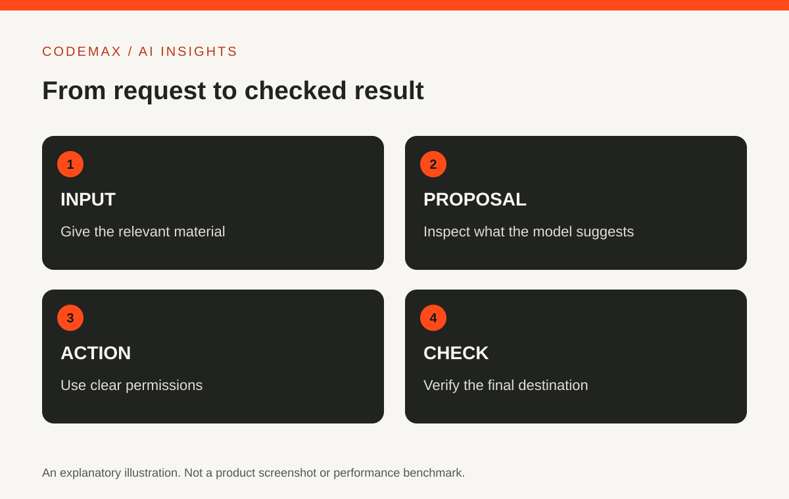

# How to Use ChatGPT: A Better Brief, a Checkable Result

Planned date (Australia/Sydney): 2026-10-21

Target keywords: chatgpt use

SEO title: How to Use ChatGPT: Brief, Review and Verify | CodeMax

Meta description: Improve everyday ChatGPT use with a clear task brief, source material, output requirements and a practical review process you can repeat.

Useful ChatGPT use starts with a task you can describe and a result you can check. You do not need a complicated prompt formula for every request. Give the assistant the context that changes the answer, state what you want produced and inspect the result before relying on it.

## Write a brief with four parts
Include the task, audience, source material and output format. For example: turn these exhibition notes into a 120-word introduction for first-time visitors, use only the supplied facts, and keep the tone welcoming. That instruction provides a purpose and boundaries.

If something is missing, ask the assistant to flag it rather than fill the gap silently. This is particularly useful for names, dates and claims that you will publish. A placeholder is easier to correct than a plausible invented detail hidden inside polished prose.

<figure>
  
  <figcaption>Contextual photograph: writing the task, audience and limits down can make a brief easier to review. This 2014 stock photograph does not show ChatGPT or an OpenAI session. Credit: Pixel.la Free Stock Photos, <a href="https://commons.wikimedia.org/wiki/File:Man_writing_while_using_his_laptop_2.jpg">original photograph and licence record</a>, <a href="https://creativecommons.org/publicdomain/zero/1.0/">CC0 1.0</a>. Resized and converted to WebP.</figcaption>
</figure>

## Use a small first draft
Request an outline or short example before asking for a large document. Check whether the approach matches the intended audience. Correct the direction early, then expand the parts that are useful.

This is not about making every interaction slow. It is about avoiding a long output built on the wrong assumption. For a straightforward task, one clear request may be enough; for an ambiguous one, a brief first pass can save substantial editing.

## Compare factual claims with their source
When you supply a document, check that the output preserves its meaning. Inspect names, numbers, dates and important exceptions. If the assistant uses external sources, open the relevant links and confirm that they support the claims.

Do not treat a request to double-check as independent verification. A second answer can repeat the same mistake. For information you do not understand, consult an appropriate authoritative source or someone qualified to assess it.

## Give feedback about the actual problem
Instead of saying make it better, identify what needs changing: the opening is too vague, the audience already knows this background, or the table is missing a comparison criterion. Specific feedback tells the assistant what to preserve and what to revise.

Keep the successful version and the final instructions if you repeat the task. They can form a useful starting point next time, although the content still needs review. A reusable brief is more dependable than trying to remember a long conversation.

<figure>
  
  <figcaption>Contextual photograph: review files and final destinations outside the chat before relying on the result. The screens are blank and do not depict ChatGPT. Credit: Norbert Levajsics, <a href="https://commons.wikimedia.org/wiki/File:Laptop_on_a_neat_desk_(Unsplash).jpg">original photograph and licence record</a>, <a href="https://creativecommons.org/publicdomain/zero/1.0/">CC0 1.0</a>. Resized and converted to WebP.</figcaption>
</figure>

## Check files and actions separately
Available features depend on your current account and tools. If the assistant creates or edits a file, open it and check the requested content. If it performs an action in another application, verify the destination rather than relying only on the response text.

Start with a low-stakes example while learning a new feature. OpenAI's current help documentation is the right place to confirm how that feature works. The practical habit is consistent across features: provide the relevant context, request a concrete output and verify the parts that matter.

## Sources and further reading

- [OpenAI: ChatGPT capabilities overview](https://help.openai.com/en/articles/9260256-chatgpt-capabilities-overview)
- [OpenAI: What is ChatGPT?](https://help.openai.com/en/articles/12677804-what-is-chatgpt-faq)

Source-based explainer first researched 30 September 2026; OpenAI documentation and image reuse terms rechecked 21 October 2026. Product features and availability can vary by plan, settings and region, and can change. Examples are illustrative unless identified as reported research.

[Explore AI insights](https://codemax.com.au/blog/ai/)

## Image rights record

Checked 21 October 2026.

- **A person writing notes beside a laptop.** Original source and licence record: [Wikimedia Commons](https://commons.wikimedia.org/wiki/File:Man_writing_while_using_his_laptop_2.jpg). Creator/source credit: Pixel.la Free Stock Photos; the file metadata also identifies Sculpt, LLC. Original date: 8 October 2014. Reuse terms: [CC0 1.0](https://creativecommons.org/publicdomain/zero/1.0/). The Commons record says the Flickr licence was reviewed and confirmed as CC0. Local derivative: `public/article-media/chatgpt-brief-notes-context-2014.webp`, resized to 1200 × 800 and converted to WebP.
- **A laptop on a tidy desk.** Original source and licence record: [Wikimedia Commons](https://commons.wikimedia.org/wiki/File:Laptop_on_a_neat_desk_(Unsplash).jpg). Creator: Norbert Levajsics. Publication date: 4 April 2017. Reuse terms: [CC0 1.0](https://creativecommons.org/publicdomain/zero/1.0/); the Commons record documents that it was published under Unsplash's pre-5 June 2017 CC0 terms. Local derivative: `public/article-media/chatgpt-review-workspace-context-2017.webp`, resized to 1200 × 800 and converted to WebP.
