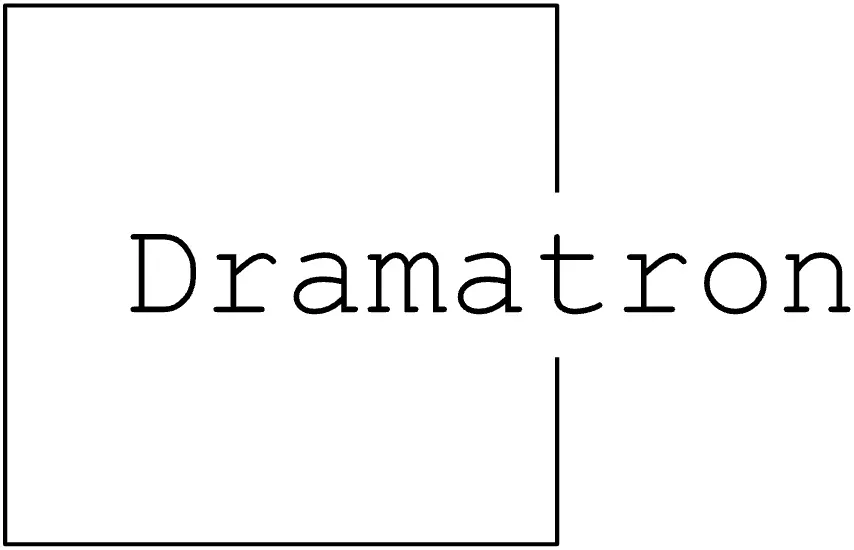
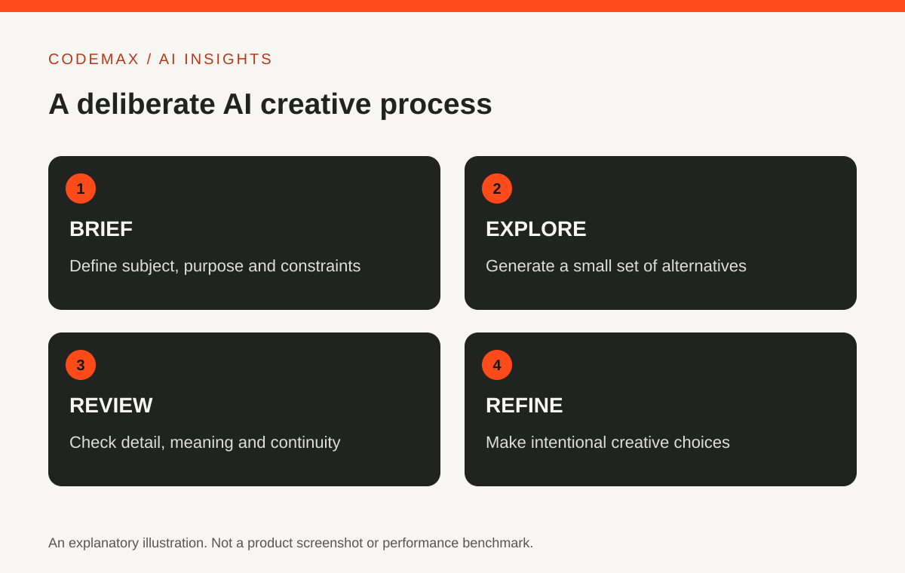
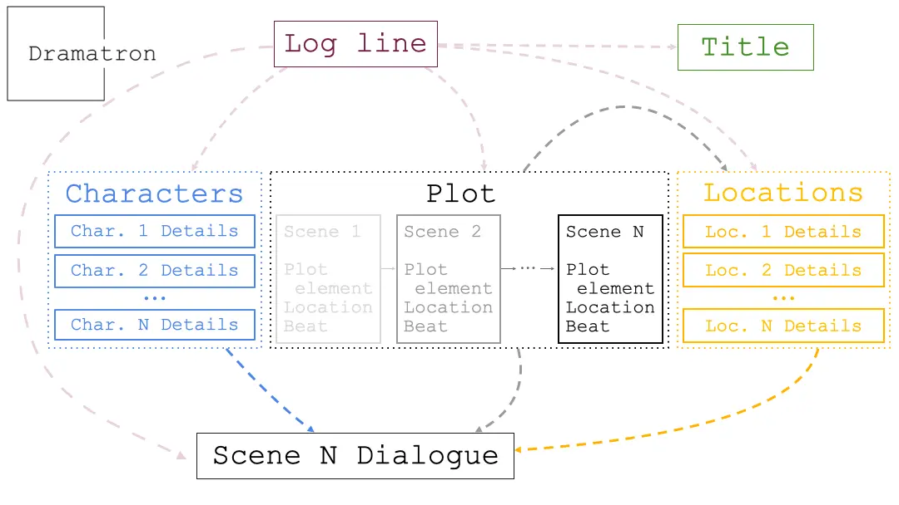

# Dramatron: What an AI Scriptwriting Research Project Can Teach Writers

Planned date (Australia/Sydney): 2026-10-24

Target keywords: dramatron

SEO title: Dramatron: AI Scriptwriting Research Explained | CodeMax

Meta description: Explore Dramatron’s approach to structured script generation, its research context and a practical way to use outlines without handing over creative judgement.

Dramatron is a research project exploring the co-writing of scripts with language models. Google DeepMind's publication describes a structured process involving elements such as characters, story beats, locations and dialogue. It is useful to read as a research example, rather than assume it is a current supported screenwriting service.

<figure>
  
  <figcaption>The official Dramatron project wordmark from the Google DeepMind source repository. This is project identity, not a screenshot of a current supported product. Credit: Google DeepMind, <a href="https://github.com/google-deepmind/dramatron/blob/2e7c36afadacf8321b77a468940024371b7a8c7a/dramatron_logo.png">original source image</a>, <a href="https://creativecommons.org/licenses/by/4.0/">CC BY 4.0</a>. Converted to WebP.</figcaption>
</figure>

## Structure comes before dialogue
A script needs more than interesting sentences. Characters have motivations, scenes change the situation and later events depend on earlier choices. Dramatron's research approach uses structural context through chained prompts to help organise generation.

The general creative lesson is that a model can be given intermediate material rather than asked to produce an entire story at once. An outline, character description and scene purpose provide constraints that a vague request for a screenplay does not.

<figure>
  
  <figcaption>A still from the official Dramatron repository animation shows the project's hierarchical writing structure, from a log line to character, plot, location and dialogue material. Credit: Google DeepMind, <a href="https://github.com/google-deepmind/dramatron/blob/2e7c36afadacf8321b77a468940024371b7a8c7a/dramatron-animation.gif">original animation</a>, <a href="https://creativecommons.org/licenses/by/4.0/">CC BY 4.0</a>. Frame extracted and converted to WebP.</figcaption>
</figure>

## Research availability is not product support
The project has a public repository and associated research materials. Its current README says the Colab is provided “unplugged”: a user must implement the model interface and supply their own language-model sampling code. Before trying old code, inspect its status, dependencies and setup instructions.

This article does not claim that the original demonstration remains available or that every dependency is supported. If your goal is learning about the method, you can study the paper and repository without treating them as a ready-made production tool.

## Try a small structural writing exercise
Create a one-paragraph premise and identify a character's goal, obstacle and choice. Write three scene beats yourself. Then, using a tool you already have, ask for alternative ways to express one beat while preserving those constraints.

Compare the suggestions with your intended story. Does the proposed dialogue reveal character, change the situation or merely restate the outline? This original exercise borrows the idea of working in stages; it is not a recreation or performance test of Dramatron.

## Keep continuity under human review
Check names, motivations, relationships and the sequence of events. A locally convincing scene can contradict an earlier one. Keep a brief story record so you can compare each draft with the decisions you want to preserve.

Also consider voice and originality. Accepting every generated suggestion can produce a script that is coherent but lacks a distinct point of view. The writer's judgement includes deciding what to leave out, which tensions matter and where a predictable suggestion should be challenged.

## Read the evaluation, not just the sample output
The paper reports evaluation by industry professionals. When reading it, look at how the study was organised and what limitations the authors discuss. A selected sample does not describe every output or establish that human revision is unnecessary.

Dramatron is interesting because it makes the writing process itself part of the AI system's design. For a general reader, the takeaway is practical: break a creative task into meaningful stages, evaluate each stage and retain responsibility for the finished work.

## Sources and further reading

- [Google DeepMind: Co-writing scripts research](https://deepmind.google/research/publications/13609/)
- [Google DeepMind: Dramatron repository](https://github.com/google-deepmind/dramatron)

Source-based explainer first researched 30 September 2026; research claims, repository status and image reuse terms rechecked 24 October 2026. The two repository images are authentic project source materials, not evidence that Dramatron is a current supported Google product. Examples are illustrative unless identified as reported research.

[Explore AI insights](https://codemax.com.au/blog/ai/)

## Image rights record

Checked 24 October 2026 against Google DeepMind repository commit 2e7c36afadacf8321b77a468940024371b7a8c7a.

- **Official Dramatron project wordmark.** Original source: [Google DeepMind Dramatron repository](https://github.com/google-deepmind/dramatron/blob/2e7c36afadacf8321b77a468940024371b7a8c7a/dramatron_logo.png). Creator/source credit: Google DeepMind. Reuse terms: the repository README licenses non-software materials under [CC BY 4.0](https://creativecommons.org/licenses/by/4.0/). Local derivative: public/article-media/dramatron-project-logo-2022.webp, 854 × 550, converted from PNG to WebP without changing the artwork.
- **Dramatron hierarchical process diagram.** Original source: [Google DeepMind Dramatron repository](https://github.com/google-deepmind/dramatron/blob/2e7c36afadacf8321b77a468940024371b7a8c7a/dramatron-animation.gif). Creator/source credit: Google DeepMind. Reuse terms: the repository README licenses non-software materials under [CC BY 4.0](https://creativecommons.org/licenses/by/4.0/). Local derivative: public/article-media/dramatron-hierarchy-still-2022.webp, 1080 × 608, extracted from the official animation and converted to WebP.
