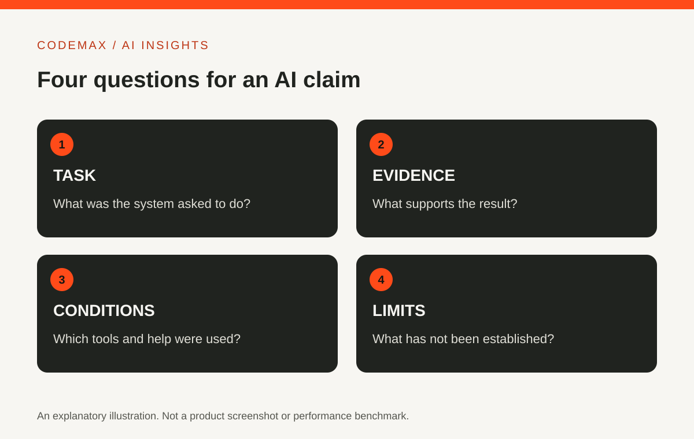
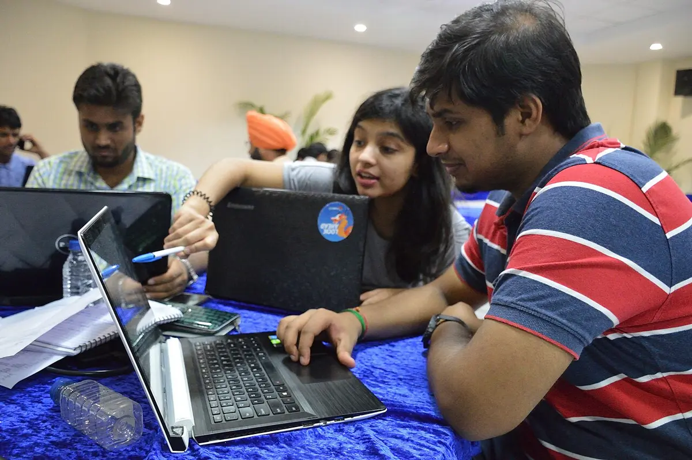
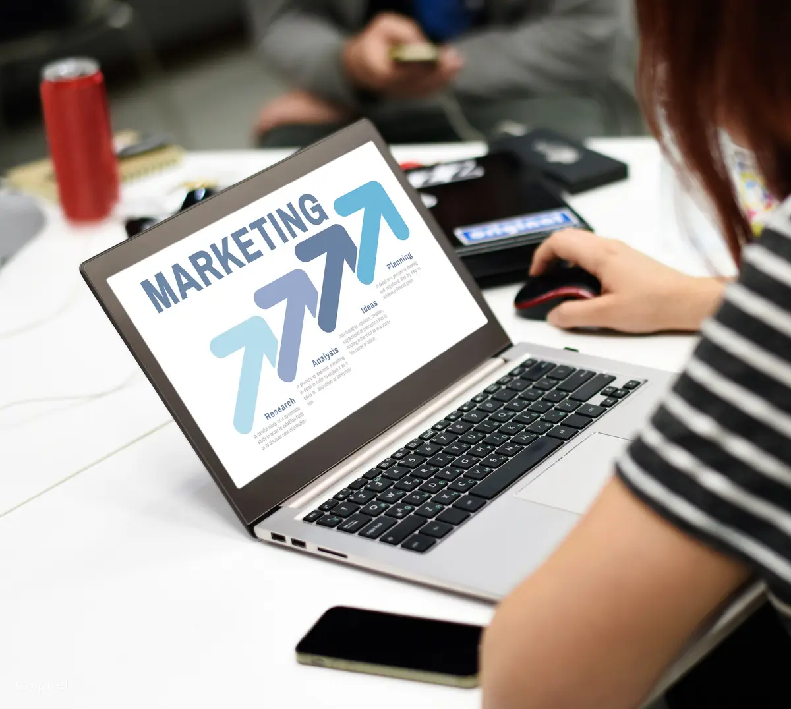

# Going to an AI Summit? Read the Agenda Before Buying a Ticket

Planned date (Australia/Sydney): 2026-10-25

Target keywords: ai summit

SEO title: AI Summit Guide: How to Evaluate the Agenda | CodeMax

Meta description: Choose an AI summit around useful sessions, evidence and learning goals. A practical guide to assessing agendas without relying on event hype.

An AI summit can mean a technical research meeting, an enterprise conference or a broader technology event. The shared label does not tell you whether its sessions suit your interests. Read the agenda as a plan for what you will learn, rather than treating a large speaker list as proof of value.

## Identify the event precisely
Check the organiser, city, edition and official event website. On 25 October 2026, the official Australia site advertised a return to Melbourne Convention and Exhibition Centre from 23–25 August 2027, while its agenda and FAQ pages still documented the September 2026 edition. A search result can therefore lead to an earlier programme even when the organiser is correct.

This article does not quote a ticket price. Dates, passes and access conditions change and should be confirmed on the organiser's current page before booking. Check the actual venue and attendance format rather than assuming every event using the same series name has the same arrangements.

## Choose a learning goal
Write down three questions you want answered. You might want to understand how an AI agent is evaluated, how creative teams use image tools, or what skills a beginner should study. Then look for sessions whose descriptions address those questions directly.

A broad keynote may provide context, while a workshop may offer a practical exercise. Both can be useful, but they serve different purposes. The published 2026 agenda separated plenaries, masterclasses, conference sessions and showcase-theatre sessions, and its FAQ described different access for different pass types. Check the current requirements instead of assuming every listed session is included.

<figure>
  
  <figcaption>Contextual photograph: participants work together during a Python workshop at WikiConference India in Mohali, 7 August 2016. This is not The AI Summit Australia. Credit: Biswarup Ganguly, <a href="https://commons.wikimedia.org/wiki/File:Shivangi_Aneja_and_Palash_Rastogi_Study_Writing_Mediawiki_Bot_in_Python_-_Wiki_Conference_India_-_CGC_-_Mohali_2016-08-07_8413.JPG">original photograph and licence record</a>, <a href="https://creativecommons.org/licenses/by/3.0/">CC BY 3.0</a>. Resized and converted to WebP; no endorsement implied.</figcaption>
</figure>

## Distinguish evidence from a sales story
Look for speakers who explain the problem, the method and what did not work. A case study becomes more informative when it includes a baseline, a measurement period and limitations. A percentage improvement without context is difficult to interpret.

During a session, note whether a capability is demonstrated live, shown in a recording or described as a future goal. These are different forms of evidence. You can appreciate an ambitious idea while keeping its maturity clear in your notes.

## Plan conversations as well as sessions
If networking matters, decide whom you want to learn from and why. Prepare a short question about their work rather than a generic request to explain AI. Respect that other attendees may be there to learn rather than receive a sales pitch.

<figure>
  
  <figcaption>Contextual stock photograph: define the conversation or decision you want to move forward before attending. The people pictured are not summit attendees. Credit: Rawpixel Ltd, <a href="https://commons.wikimedia.org/wiki/File:Startup_Business_People_Working_on_Laptop_Copy_Space_(26666482937).jpg">original photograph and licence record</a>, <a href="https://creativecommons.org/licenses/by/2.0/">CC BY 2.0</a>. Resized and converted to WebP; no endorsement implied.</figcaption>
</figure>

Leave room in your schedule to reflect. Moving from one presentation to another without writing down conclusions can make a busy day surprisingly hard to use afterwards. A brief note after each session is often more valuable than collecting every slide.

## Turn attendance into a small follow-up project
Choose one idea to test after the event. Define the input, expected output and a way to evaluate it. Keep links to the original sources so you can distinguish what the speaker claimed from what you observed yourself.

An event is worthwhile when it helps you make a better decision, learn a useful skill or form a relevant connection. The agenda, practical requirements and evidence on offer are better guides than the word summit alone.

## Sources and further reading

- [The AI Summit Australia: About the series](https://australia.theaisummit.com/about/)
- [The AI Summit Australia: Official website](https://australia.theaisummit.com/)
- [The AI Summit Australia: Published 2026 agenda](https://australia.theaisummit.com/agenda/)
- [The AI Summit Australia: FAQs and pass access](https://australia.theaisummit.com/faqs/)

Source-based explainer first researched 30 September 2026; official event information and image reuse terms rechecked 25 October 2026. The photographs are independently licensed context and do not depict The AI Summit Australia. Examples are illustrative unless identified as reported research.

[Explore AI insights](https://codemax.com.au/blog/ai/)

## Publication review — 25 October 2026

- The current official homepage supports the 23–25 August 2027 Melbourne Convention and Exhibition Centre dates.
- The organiser's published 2026 agenda and FAQ support the distinction between plenaries, masterclasses, conference/showcase streams and pass-specific access.
- No current ticket price, attendance total, performance outcome, ranking, endorsement or CodeMax affiliation is asserted.
- The agenda-evaluation checklist remains CodeMax editorial guidance, not a claimed test of the event.

## Image rights record — checked 25 October 2026

1. **Historical programming-workshop photograph.** Biswarup Ganguly, own work, 7 August 2016. Original source and individual licence: [Wikimedia Commons file record](https://commons.wikimedia.org/wiki/File:Shivangi_Aneja_and_Palash_Rastogi_Study_Writing_Mediawiki_Bot_in_Python_-_Wiki_Conference_India_-_CGC_-_Mohali_2016-08-07_8413.JPG). Reuse terms: [CC BY 3.0](https://creativecommons.org/licenses/by/3.0/). Local file: `public/article-media/cognitiveclass-python-workshop-2016.webp`, 1200 × 798, resized and converted to WebP. The visible caption identifies the 2016 WikiConference India workshop and does not present it as an AI Summit event. The Commons personality-rights notice was considered; no endorsement or commercial relationship is implied.
2. **Collaborative planning stock photograph.** Rawpixel Ltd, 21 April 2017. Original source and individual licence: [Wikimedia Commons file record](https://commons.wikimedia.org/wiki/File:Startup_Business_People_Working_on_Laptop_Copy_Space_(26666482937).jpg). The Commons record includes a Flickr licence review confirming [CC BY 2.0](https://creativecommons.org/licenses/by/2.0/). Local file: `public/article-media/konverge-pilot-planning-2017.webp`, 1200 × 1076, resized and converted to WebP. The visible caption labels it as contextual stock photography and not summit attendance.

Both are distinct real photographs integrated between relevant sections with descriptive alt text, explicit dimensions, lazy loading, creator/source credit, licence links and transformation notices. The existing orange-and-charcoal SVG is retained but is not counted toward the two-photo requirement.
